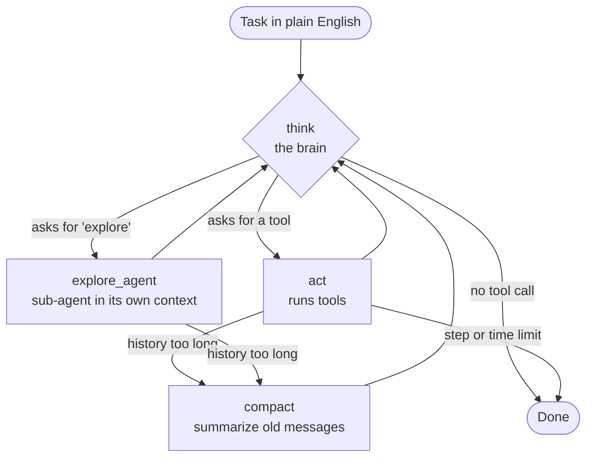

# Terminal Agent

A small terminal coding agent built with **LangGraph**, inspired by Claude Code and Codex.
It takes a task in plain English, then loops **think → act → think** until the task is done,
running real shell commands and reading/writing files.

It is evaluated on **[Terminal-Bench](https://github.com/laude-institute/terminal-bench)**,
the public benchmark used to compare terminal agents.

---

## Why this project

Building the agent loop is easy. Making it **survive real tasks** is the hard part.
This project focuses on the parts most agent demos skip:

- **Durability:** checkpointing, so a crashed run can resume
- **Context management:** a sub-agent and compaction, so long tasks don't drown in their own history
- **Observability:** every step traced in LangSmith, used to find and fix real bugs
- **Honest measurement:** results on a public benchmark, including failures

---

## Architecture



| Part | What it does |
|---|---|
| `think` | Calls the model with a system prompt and the full history; decides the next action |
| `act` | Runs the requested tools (`bash`, `read`, `write`, `edit`, `ls`); tool errors go back to the model instead of crashing |
| `explore_agent` | A sub-agent for multi-step investigation. It works in a separate message list and returns only a short summary, so the main context stays small |
| `compact` | When history passes 20 messages, summarizes the older part. The cut never splits a tool call from its result |
| Checkpointer | SQLite (`checkpoints.db`): state is saved after every node, runs can resume by `thread_id` |
| LangSmith | Full trace of every model call and tool call |

**Where commands run (3 modes):**

- **Host:** directly on your machine, with a command blocklist and git auto-commit on file changes
- **Docker sandbox:** a throwaway container with no network and a memory cap (`USE_DOCKER_SANDBOX = True`)
- **Terminal-Bench:** commands are typed into the benchmark's own tmux session inside the task container

**Safety and limits:** output truncation (2,000 lines), step limit (40), per-command timeout,
and a per-task time budget read from each Terminal-Bench task's own limit.

---

## Results on Terminal-Bench

All runs: `terminal-bench-core 0.1.1`, model `gpt-4o-mini`, one task at a time.

| Version | Tasks | Resolved | What happened (from LangSmith traces) |
|---|---|---|---|
| v1: no system prompt | 7 | 0 | Agent acted like a chatbot: explained solutions in text and quit after 5 to 19 seconds |
| v2: system prompt + timeout and blocklist fixes | 5 | 0 | Agent now worked for minutes, but 4 of 5 runs crashed on agent-side bugs (see below) |
| v3: + compaction, tool-error and time-budget fixes | 5 | 0 | No crashes. Every task ended by the agent's own decision. `nginx-request-logging` passed **5 of 8** sub-tests |

`hello-world` passes (100%).

> Note: Terminal-Bench counts a task as solved only if **all** its tests pass.
> On my machine I raised the checker's test timeout to 180s (`--global-test-timeout-sec 180`),
> because the checker downloads its test tools and my internet made it exceed the default 60s.

### Bugs found through tracing and fixed

1. **No instructions:** the model explained instead of acting → added a system prompt (act, verify, retry, never ask the user)
2. **Commands cut off at 60s:** long installs were killed mid-download → longer timeout, plus Ctrl+C recovery so the next command never lands in a busy terminal
3. **Blocklist too strict in a sandbox:** `sudo apt install` was blocked inside a throwaway container → blocklist applies only on the host
4. **Compaction split a tool call from its result:** the API rejected the history → the cut point now always starts at a non-tool message
5. **A malformed tool call crashed the run:** e.g. `edit` without `new_text` → errors are returned to the model so it can correct itself
6. **No sense of time:** the agent kept working after the task's limit → a deadline from each task's own `task.yaml`, with a wrap-up warning in the last minute
7. **Unanswered tool calls:** `explore` plus another tool in one message left one call unanswered → every tool call now gets a result

### Remaining failures (model reasoning, not infrastructure)

- **Wrong output location:** in `intrusion-detection` the agent saved scripts in `/app/logs/` (where the input logs live) instead of `/app/`, so every test failed
- **Missed requirements:** in `nginx-request-logging` the server worked, but the homepage text, custom 404 page and some settings were missed
- **Ran out of steps or time** on harder tasks (`polyglot-c-py`, `git-multibranch`)

**Next experiments:** (1) prompt nudges for these patterns (save in the working directory,
`chmod +x` and run new scripts, check every requirement before finishing),
(2) the same tasks with a stronger model, to separate instruction gains from model gains.

---

## Run it

**Requirements:** Python 3.12+, an OpenAI or Anthropic API key. Terminal-Bench needs Linux (or WSL on Windows) and Docker.

```bash
python3 -m venv .venv && source .venv/bin/activate
pip install -r requirements.txt
```

Create a `.env` file:

```
OPENAI_API_KEY=your-key
ANTHROPIC_API_KEY=your-key        # optional
LANGCHAIN_API_KEY=your-langsmith-key
AGENT_MODEL=gpt-4o-mini           # optional, change the model without editing code
```

**Run the agent locally** (edit the task at the bottom of the file):

```bash
python terminal_agent.py
```

**Run on Terminal-Bench** (one task at a time, the adapter uses shared state):

```bash
tb run --dataset-name terminal-bench-core --dataset-version 0.1.1 \
  --agent-import-path tbench_adapter:MyTerminalAgent \
  --task-id hello-world --n-concurrent 1 --global-test-timeout-sec 180
```

---

## Files

| File | Purpose |
|---|---|
| `terminal_agent.py` | The agent: state, tools, nodes, routing, graph, checkpointing |
| `tbench_adapter.py` | Plugs the agent into Terminal-Bench (tmux session, per-task deadline) |
| `requirements.txt` | Python dependencies |

## Known limitations

- The Terminal-Bench adapter uses global state, so tasks must run one at a time (`--n-concurrent 1`)
- The host blocklist is a simple word filter, not real security. Use the Docker sandbox for untrusted tasks
- Results so far use a small model on a small set of tasks

## Inspired by

- [pi](https://github.com/earendil-works/pi): output truncation, compaction, a small focused toolset
- [Aider](https://github.com/Aider-AI/aider): git commit after every file change
- Claude Code: sub-agents for context isolation
- OpenAI Codex: sandboxing as a separate layer
